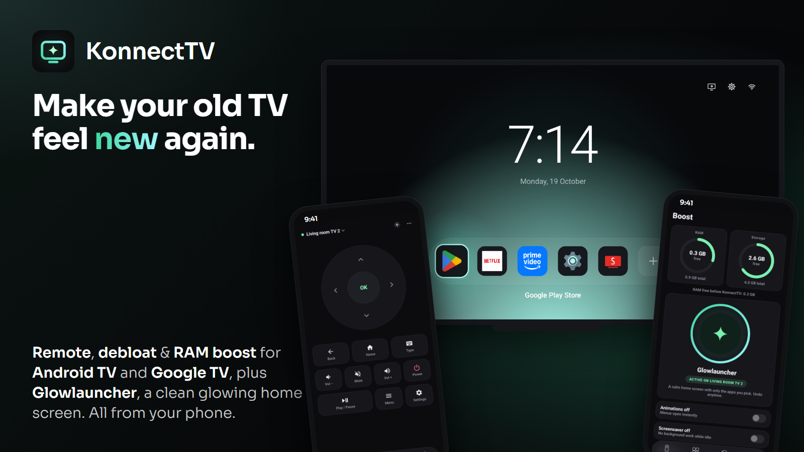

<p align="center"></p>

<h1 align="center">KonnectTV — Android 9+ Fork</h1>

This fork supports **Android 9+ phones and Android TV 9+**. It keeps the phone companion and bundles Glowlauncher for the TV. Download this fork's development-signed test builds from [Releases](https://github.com/ankitchanki/konnect-tv-Android-9/releases).

<p align="center"></p>

**Make your old Android TV feel new again, from your phone.** Turn off the bloat, free up memory, swap the cluttered home screen for a clean glowing one, and control everything with a remote on your phone.

<p align="center"></p>

<p align="center">
  
  
  
  
</p>

<p align="center"><a href="https://github.com/ankitchanki/konnect-tv-Android-9/releases"><b>⬇ Download the Android 9+ build</b></a></p>

## Why this fork?

The original project provides the phone remote, app management, Detox, Boost and Glowlauncher. This fork keeps that workflow, lowers the phone requirement to Android 9, and adds phone-controlled wallpapers and clearer controls for managing several saved TVs.

Compared with the upstream source this fork started from (`9d46e4c`):

| Capability | Original KonnectTV | This fork |
|:--|:--|:--|
| Phone app minimum | Android 12 (API 31) | Android 9 (API 28), with solid surfaces on Android 9–11 |
| Standalone launcher minimum | Android TV 5 (API 21) | Android TV 9 (API 28); this fork focuses on Android 9+ devices |
| Install launcher from phone | Bundled Glowlauncher via Boost | Retained; no separate TV download required |
| Launcher background | Glow colours and RGB | Glow plus a photo selected on the phone |
| Wallpaper framing | No phone wallpaper editor | TV-ratio preview, Fill/crop, Fit, pinch/drag, zoom, position and dimming controls |
| Saved connections | Remembers TVs and reconnects | Retained, plus editable names, tags, saved IP/port and a **Use last IP** button |
| Android 9 connection/setup | Phone app requires Android 12 | Legacy network ADB guidance, remote discovery and compatible Home selection |
| Validation | Existing upstream checks | Added crop geometry, storage migration, UI and wallpaper-transfer regression tests |

Android 9+ is the minimum supported version, not a guarantee for every manufacturer's firmware or future Android release. Debugging access and permission to replace the Home screen still depend on the TV. Physical TV testing remains necessary.

## Real results

Upstream measurements on a 1 GB Google TV (CHiQ, Android 14): Google TV's own home with apps left running, then Glowlauncher after Boost cleared background apps. Median of 3 cold starts each. These measurements have not been repeated for this fork or with photo wallpaper enabled.

| | Before | After KonnectTV |
|:--|--:|--:|
| Netflix opens in | 1.72 s | **0.85 s** (2× faster) |
| Prime Video opens in | 3.37 s | **1.87 s** (1.8× faster) |
| Home screen memory | 80 MB | **21 MB** (4× lighter) |
| Free memory | 255 MB | **308 MB** |

Your TV will differ. The older and more cluttered it is, the bigger the gain. Raw output, method and the script to run it yourself: [docs/BENCHMARK.md](docs/BENCHMARK.md).

## Features

- ✨ **Glowlauncher.** A calm home screen for your TV: a big clock and only the apps you pick, in one glowing dock. Choose the glow colour, or RGB to fade through all of them.
- 🖼️ **Wallpapers from your phone.** Pick a photo, preview it at your TV's aspect ratio, crop or fit it, zoom and reposition, then apply it directly to Glowlauncher. Restore the glow background anytime.
- 🧹 **Detox.** One tap turns off sponsored rows, screensavers and promo apps. Apps are turned off, never deleted, and every change can be undone.
- ⚡ **Boost.** See free RAM and storage, turn off animations so menus open instantly, stop the screensaver, set a sleep timer and clear background apps.
- 🎮 **Remote.** D-pad, OK, back, home, volume, mute, power and play/pause, with haptics on every tap. Type on the TV with your phone keyboard.
- 📦 **App manager.** Every app on the TV with its real icon and name. Open, force stop, clear data, turn off or on, uninstall your own apps, and install an APK from your phone.
- 📺 **Named saved TVs.** Finds Android TVs on your Wi-Fi and remembers successful connections. Add names and tags such as Living room or Friend's TV, edit saved addresses and reuse the last IP without typing.
- 🌗 **Light and dark.** One tap on the top bar.
- 🔒 **Private.** No account, no ads, no tracking. Everything stays on your phone and your TV.

## Install

This Android 9+ adaptation keeps KonnectTV as a **phone companion** for Android TV and Google TV running Android 9 or newer. The phone also needs Android 9 (API 28) or newer. Android 9–11 phones use solid floating surfaces; Android 12+ keeps backdrop blur.

Install the companion APK on your **phone**. Glowlauncher is bundled inside it and is installed on the TV from **Boost**. The separate Glowlauncher APK is only needed for manual launcher installation; it is not the phone companion.

Download `KonnectTV-Android9.apk` from [this fork's Releases page](https://github.com/ankitchanki/konnect-tv-Android-9/releases) and install it on your phone. `Glowlauncher.apk` is the optional standalone TV launcher; the phone APK already bundles it. These are development-signed prereleases. See the release notes and [Actions](https://github.com/ankitchanki/konnect-tv-Android-9/actions) for validation results. Physical TV testing has not been completed.

You can also build this source or use the `KonnectTV-Android9-test-build` artifact from this fork's **Actions** tab. If an upstream build with the same package name is already installed, Android may require uninstalling it first because its signing key differs. Uninstalling removes that app's saved connections and history.

## Set up the TV (once)

1. On the TV, open **Settings › Device Preferences › About** (or **System › About**).
2. Press OK on **Build** 7 times until it says you are a developer.
3. Go back to **Developer options** and turn on **USB debugging**. If you see **Wireless debugging** or **Network debugging**, turn that on too.

## Connect

Put the phone and the TV on the same Wi-Fi and open KonnectTV. It finds Android TVs on the network by itself.

- **TVs with Wireless debugging** (Android 11 and newer): on the TV, open **Wireless debugging › Pair device with pairing code**. Tap the TV in KonnectTV and type the 6-digit code.
- **Other TVs**: tap the TV. It asks **"Allow debugging?"**. Tick **Always allow** and press **Allow**.
- **TV not listed?** Tap **Enter IP address manually**. The IP is under the TV's network settings. The port is 5555, or the one shown under Wireless debugging.

After the first time, KonnectTV remembers the TV and reconnects in one tap.

### Remember names, tags and the last IP

- In **Enter IP address manually**, optionally enter a name and tag before connecting. The TV is saved after a successful connection.
- Tap a **Saved TVs** card to reconnect. **Edit** changes its name, tag or IP/connection port; address changes apply to the next connection.
- **Use last IP · TV name** fills the manual form with the most recently connected TV's details. When discovery knows a newer wireless-debugging port, it uses that port.
- While connected, open the TV menu on the Remote tab and choose **Edit TV name, tag or IP**. **Switch TV** returns to the saved list.
- Names, tags, addresses and ADB authorization keys stay in app storage on this phone. Existing saved TVs migrate automatically. If your router changes an IP, discover the TV again or edit its saved address.

### Android TV 9–10

These versions do **not** have Android 11's wireless pairing-code flow. Enable **USB debugging** and, if the TV offers it, **Network debugging** or **ADB over network**, then connect to the TV's IP on port **5555**. Approve the debugging prompt on the TV. USB debugging by itself does not enable network ADB on every model.

If your TV has no network debugging switch but supports USB ADB, connect it to a computer once, authorize that computer, and run `adb tcpip 5555`. Disconnect USB and enter the TV IP in KonnectTV. Some manufacturers disable network ADB entirely; KonnectTV cannot bypass that restriction. Network ADB may need enabling again after a TV reboot. Turn it off when you no longer need it, and use it only on a trusted local network.

Android 9 launcher setup uses `cmd package set-home-activity`; Android 10+ also tries the Home role. App management, remote commands and undo remain in the companion.

## Safe by design

- Apps are **turned off** (`pm disable-user`), never deleted. Undo one change or everything from **Detox › History**.
- KonnectTV never turns off Google Play, Play services, keyboards, Bluetooth, HDMI/TV inputs, Settings or the system UI. This applies to Detox and the app manager.
- Only apps you installed yourself can be uninstalled. System apps can only be turned off.
- Current launcher setup keeps the stock launcher enabled. It selects Glowlauncher as Home, or uses its Home-button accessibility service when the TV requires that fallback. Removing Glowlauncher restores recorded settings.
- The safe-to-turn-off list is in [`app/src/main/assets/debloat.json`](app/src/main/assets/debloat.json). Each entry has a plain-English reason. Pull requests for more brands are welcome.

Works on Android TV and Google TV: Sony, TCL, Hisense, Philips, Xiaomi, Chromecast with Google TV, NVIDIA Shield and others. Samsung (Tizen), LG (webOS) and Roku don't run Android, so they can't be cleaned this way.

## Glowlauncher

Glowlauncher is KonnectTV's own home screen for the TV: a big clock and the apps you pick in one glowing dock, with Inputs, Settings and network at the top right. It ships inside KonnectTV, so no launcher download is needed. On the TV, hold OK or press Menu on an app to move or remove it. The **+** tile adds one. Turn it off from **Boost** to get the TV's own home back.

### Set a TV wallpaper from your phone

1. Connect to the TV, open **Boost**, and turn on Glowlauncher. The phone installs the bundled launcher on the TV over the authorized ADB connection.
2. In **TV wallpaper**, tap **Choose wallpaper** and select an image using the system file picker. No broad photo or storage permission is needed.
3. The editor reads the TV's display dimensions and shows its aspect ratio. If the TV doesn't report a size, it uses a labelled 16:9 fallback.
4. Choose **Fill / crop** for an edge-to-edge image, or **Fit whole image** to preserve the full photo with black bars where necessary. Pinch to zoom, drag to reposition, or use the zoom and position sliders. Adjust darkening to keep the clock and dock readable.
5. Tap **Apply to TV**. The photo is prepared on the phone and transferred directly to the selected TV. An older Glowlauncher from this fork is updated in place when needed; its apps and glow settings are retained.

Wallpaper stays on that TV across launcher restarts. **Restore glow background** removes it. Each TV has its own wallpaper; uninstalling Glowlauncher deletes its wallpaper and settings.

Output preserves the detected aspect ratio and is capped at a 1920-pixel longest edge and 2,073,600 pixels, including on a 4K TV, to limit memory on older devices. Camera rotation is respected. Transfer checksums and an atomic save keep an interrupted upload from replacing the previous background. The launcher's wallpaper inbox accepts only its own process or an authorized ADB shell, and has no network listener or external-storage permission.

**Turning it on can freeze low-memory TVs for a minute or two.** Changing the home screen is the heaviest thing a TV does. KonnectTV clears background apps first and shows each step on your phone while it works. If the TV freezes, leave it on and don't unplug it. It recovers by itself.

> Use at your own risk. This is what works on the TVs we tried. It is not professional advice.

## Build it yourself

You need a full **JDK 21** (including `javac`) and the Android SDK (platform **37.0**, build-tools **36.0.0**). Use recent Android command-line tools; the platform's package name is `platforms;android-37.0`.

```sh
./gradlew :app:testDebugUnitTest :app:lintDebug :glowlauncher:lintRelease :app:assembleDebug
```

The installable test companion is at `app/build/outputs/apk/debug/app-debug.apk`. The bundled TV launcher is at `glowlauncher/build/outputs/apk/release/glowlauncher-release.apk`. For an optimized production build, configure your own persistent signing key below, then run `./gradlew :app:assembleRelease`.

To run the connection, wallpaper and saved-storage tests on an emulator or a dedicated test device (the wallpaper test temporarily replaces the launcher's background):

```sh
./gradlew :glowlauncher:installRelease :app:connectedDebugAndroidTest
```

Tests cover connection-port validation, the wallpaper editor, old saved-TV migration, names/tags/address persistence, and the real shell wallpaper upload/commit/clear path. Wallpaper checks cover restart persistence, checksum rejection and blocked access from another app. They do not prove compatibility with every TV manufacturer's ADB implementation. The workflow in `.github/workflows/android.yml` builds both APKs and runs emulator tests on API 28 and API 36.

The app uses Kotlin and Jetpack Compose. Glowlauncher (`glowlauncher/`) uses plain Android views so it stays small and runs on Android TV 9 and newer in this adaptation. It also has a TV launcher entry and banner for launching it directly from the TV's apps screen. ADB runs on [libadb-android](https://github.com/MuntashirAkon/libadb-android), which handles pairing and TLS. The frosted glass uses [Haze](https://github.com/chrisbanes/haze).

To sign a release build, create `keystore.properties` in the project root. Never commit it.

```properties
storeFile=konnecttv.jks
storePassword=...
keyAlias=konnecttv
keyPassword=...
```

## Credits

This project is a fork of [KonnectTV by yashoncode](https://github.com/yashoncode/konnect-tv). Credit for the original app and Glowlauncher belongs to the upstream project. This fork adds Android 9+ compatibility while retaining the phone companion.

Inspired by [TV Detox](https://github.com/Ansub/tv-detox). Glowlauncher is based on TV Detox's home screen.

## License

MIT
