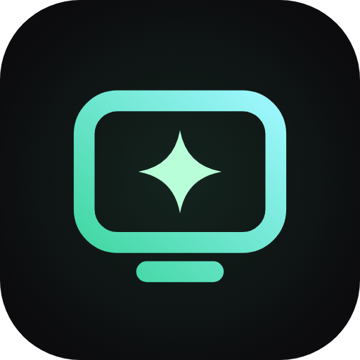
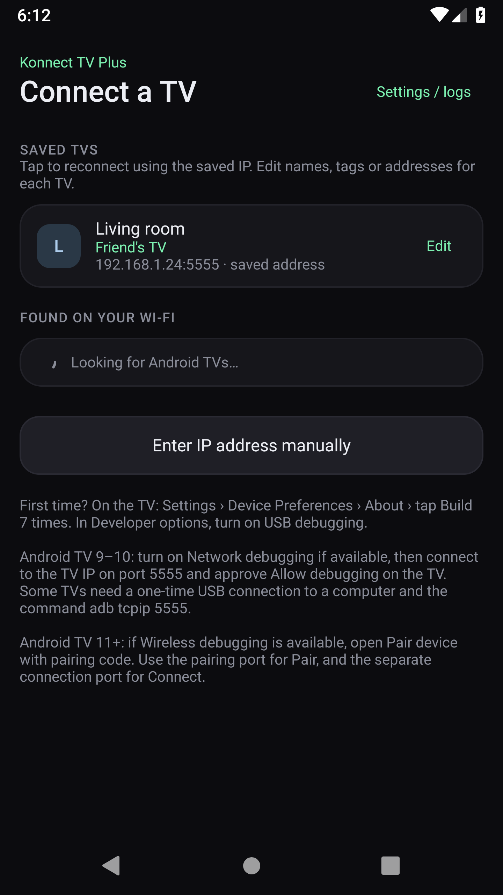
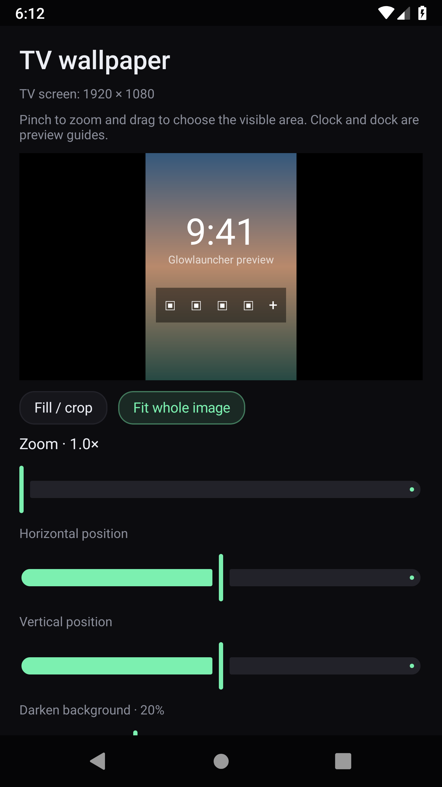
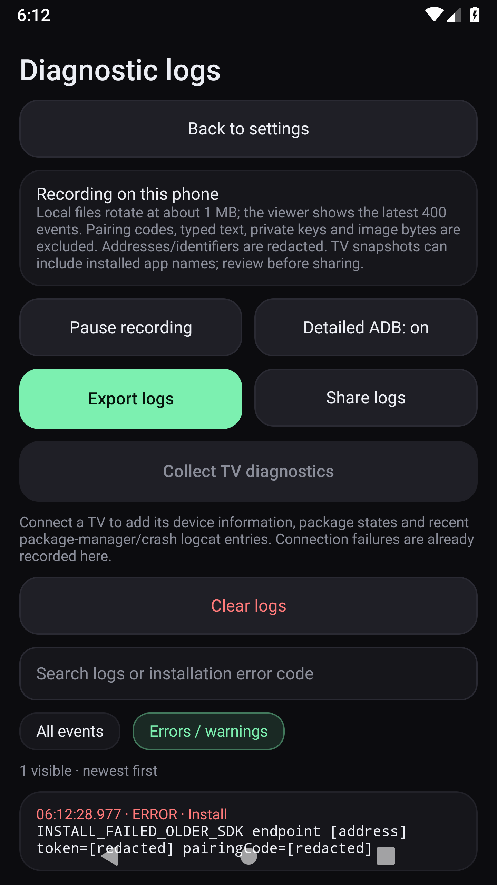
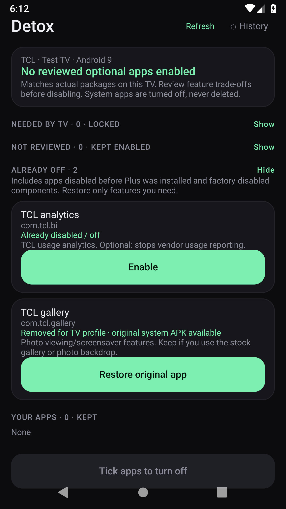
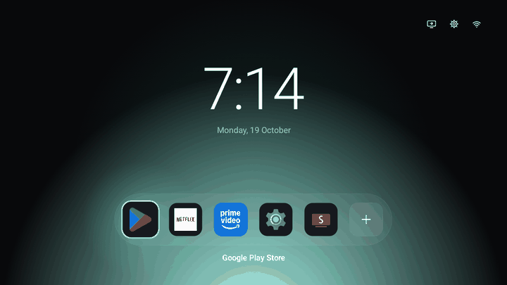
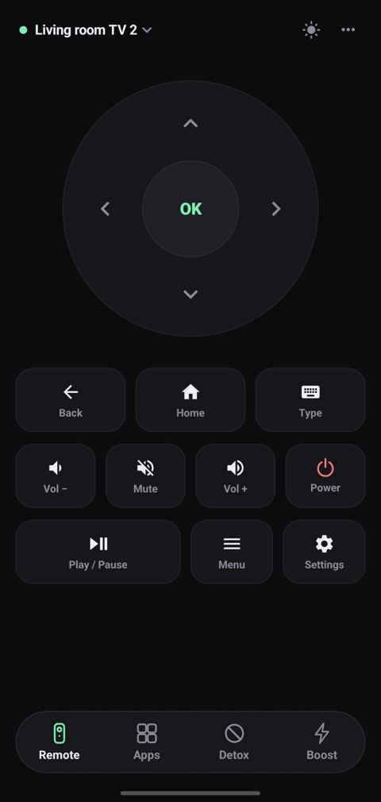
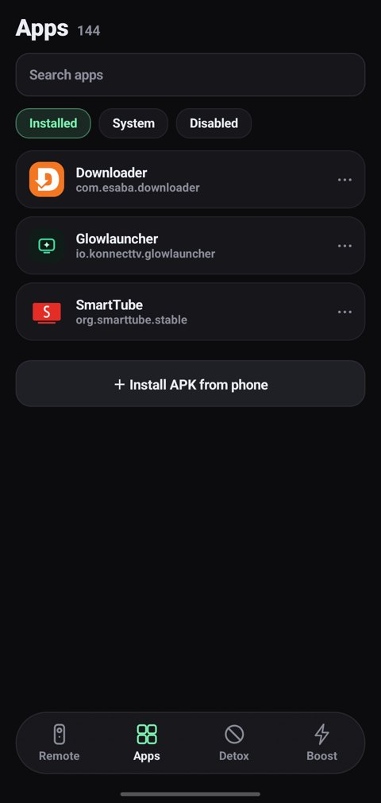
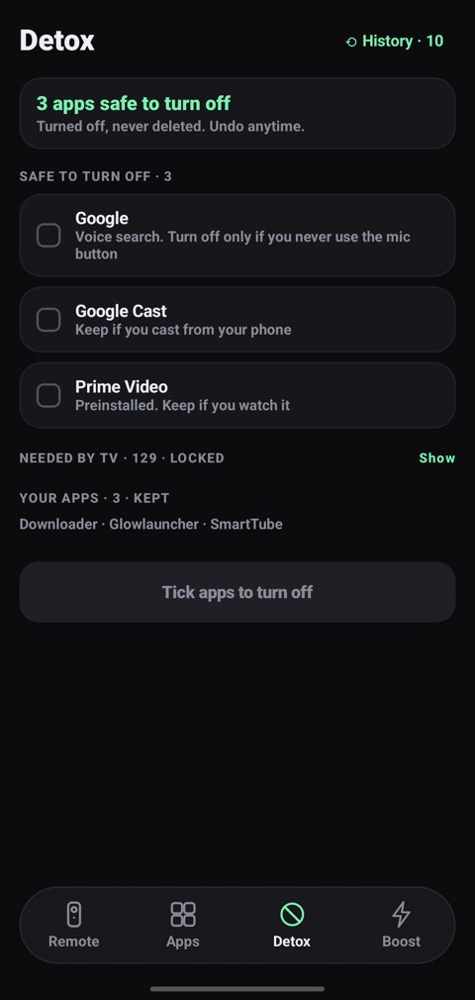
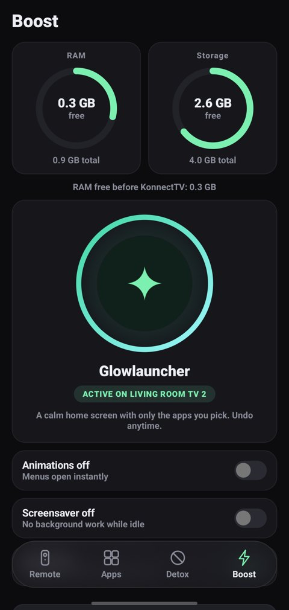

<p align="center"></p>

<h1 align="center">Konnect TV Plus</h1>

**An Android 9+ phone companion for Android TV 9+: remote control, app management, a clean TV launcher, phone-selected wallpapers and local diagnostics.**

This is a fork of [KonnectTV by yashoncode](https://github.com/yashoncode/konnect-tv). Original app and Glowlauncher credit belongs to upstream. This fork adds Android 9 compatibility, wallpaper editing, named TV connections, diagnostics and reviewed package controls.

[Download APKs](https://github.com/ankitchanki/konnect-tv-Android-9/releases) · [Build and emulator results](https://github.com/ankitchanki/konnect-tv-Android-9/actions) · [Package catalog and sources](docs/PACKAGE-CATALOG.md)

## UI previews

Screenshots from **Konnect TV Plus 2.0.0 on Android 9**, using sample TV and package data. Tap an image to open it at full size.

<table>
  <tr>
    <th>Saved TVs, names and tags</th>
    <th>TV wallpaper editor</th>
  </tr>
  <tr>
    <td align="center"><a href=".github/assets/plus/saved-tvs.png"></a></td>
    <td align="center"><a href=".github/assets/plus/wallpaper-editor.png"></a></td>
  </tr>
  <tr>
    <td>Reconnect using a saved address; edit the TV name and tag. The manual form also offers Use last IP.</td>
    <td>Frame a wallpaper for the TV with crop/fit, zoom, position and dimming. The image shown is a sample gradient.</td>
  </tr>
  <tr>
    <th>Diagnostic logs</th>
    <th>Already off and app recovery</th>
  </tr>
  <tr>
    <td align="center"><a href=".github/assets/plus/diagnostic-logs.png"></a></td>
    <td align="center"><a href=".github/assets/plus/already-off.png"></a></td>
  </tr>
  <tr>
    <td>Inspect connection and installation errors from the first launch. Export or share a report when troubleshooting.</td>
    <td>See packages disabled before Plus was installed, read their feature trade-offs, and enable or restore them.</td>
  </tr>
</table>

These UI captures use test fixtures; they are not evidence of testing a physical TCL TV. [Screenshot provenance](.github/assets/plus/README.md).

### Glowlauncher on the TV

<p align="center"></p>

The upstream animation shows the original glow background. Plus also lets you apply a phone-selected wallpaper using the editor above.

<details>
<summary>Original core screens: Remote, Apps, Detox and Boost</summary>

These upstream screenshots show the original workflow retained in Plus. They are references for the earlier UI; current Plus adds Settings and the screens above.

<p align="center">
  <a href=".github/assets/remote.jpg"></a>
  <a href=".github/assets/apps.jpg"></a>
  <a href=".github/assets/detox.jpg"></a>
  <a href=".github/assets/boost.jpg"></a>
</p>

Original UI images and animation are credited to [KonnectTV by yashoncode](https://github.com/yashoncode/konnect-tv).

</details>

## Install and connect

1. Install **KonnectTVPlus.apk on your phone**. The phone and TV both need Android 9 (API 28) or newer and must be reachable on the same local network.
2. On the TV, enable Developer options and debugging. Android 11+ TVs with Wireless debugging use their pairing code and connection port. For Android TV 9–10, use the TV's network/ADB debugging option and normally port **5555**, then approve **Allow debugging** on the TV. USB debugging alone does not enable network ADB on every model.
3. Pick a discovered TV or choose **Enter IP address manually**. Enter an optional name and tag, such as Living room / Home or Bedroom / Friend's TV. Successful connections are remembered.
4. Open **Boost** to install and enable **Glowlauncher directly from the phone**. Its APK is bundled; a separate TV download is unnecessary. `Glowlauncher.apk` in Releases is available for manual TV installation.

**Plus uses a new phone package, `io.konnecttv.plus`.** It installs separately from the older `io.konnecttv` companion. Saved TVs, authorization keys, history and preferences cannot migrate automatically across these package IDs: reconnect and approve Plus on each TV. Keep the older app until any changes you need its undo history for have been restored.

The TV launcher's package remains **`io.konnecttv.glowlauncher`**, so a compatible signed update preserves its existing wallpaper and home settings. A launcher installed from another signing key can require uninstalling first; that deletes its local settings. Installation failures and signature mismatch advice appear in diagnostics.

If the TV has no network debugging switch but permits USB ADB, a computer can authorize it once and run `adb tcpip 5555`. Some firmware disables network ADB entirely. Plus cannot bypass that restriction. Use debugging on a trusted network and turn it off when finished. Samsung Tizen, LG webOS and Roku are not Android TV.

Release APKs are **development-signed prereleases**. API 28 and API 36 emulator checks cover the tested paths; physical TCL and other manufacturer TV testing is still needed. The minimum supported version does not guarantee every firmware or future Android version.

## What changed from the original?

Comparison with the upstream source this fork started from (`9d46e4c`):

| Capability | Original KonnectTV | Konnect TV Plus |
|:--|:--|:--|
| Phone identity | KonnectTV / `io.konnecttv` | Konnect TV Plus / `io.konnecttv.plus` |
| Phone minimum | Android 12 / API 31 | Android 9 / API 28; solid surfaces on Android 9–11 |
| TV launcher minimum | Android TV 5 / API 21 | Android TV 9 / API 28 |
| Install launcher from phone | Bundled Glowlauncher | Retained in Boost |
| TV wallpaper | Glow colours and RGB | Phone photo picker, TV-ratio preview, crop/fit, pinch, drag, zoom and dimming |
| Saved TVs | Saved connections | Editable names, tags, addresses/ports and **Use last IP** |
| Diagnostics | Status messages | Settings before connection, persistent rotating logs, filters, export/share and TV snapshots |
| Package rules | Existing Detox rules | TCL and other OEM exact-package rules, source links, feature trade-offs and protected component reasons |
| Existing disabled apps | Excluded from inventory | **Already off**, Enable and available system-app restoration, including changes made outside Plus |
| Unknown system apps | Grouped with needed apps | Explicit **Not reviewed**, kept enabled |
| Error handling | Some commands inferred success | Checked exit codes, full installation responses, timeout/error logs and state verification |

## Features

- **Remote:** D-pad, OK, back, home, volume, mute, power and playback; type on the TV using the phone keyboard.
- **Apps:** Actual inventory including disabled apps, icons, state and reason. Open apps, install a phone-selected APK, manage reviewed optional apps or your own apps. Critical and unreviewed system apps are protected from destructive actions.
- **Detox:** Automatically identifies manufacturer/model and matches the packages actually present. New vendor rules start unchecked. Read each reason before disabling; use **Already off** to enable an app disabled before Plus was installed.
- **Boost:** RAM/storage information, animation controls, screensaver, sleep timer and background-app cleanup. Glowlauncher keeps the stock launcher installed and enabled; Home selection depends on TV permissions and firmware.
- **Saved TVs:** One-tap reconnect; edit names, tags and addresses. **Use last IP · TV name** fills the manual connection form with the latest saved TV.
- **Diagnostics:** Connection attempts, discovery errors, command exit codes, installation responses, wallpaper operations and phone crashes. Logs stay on the phone until you export/share.
- **Light/dark appearance:** Android 9-compatible UI with blur on newer phones.

### Wallpapers from your phone

Connect, enable Glowlauncher in **Boost**, then choose **TV wallpaper → Choose wallpaper**. The system picker needs no broad photo permission. The editor detects the TV's dimensions, or labels its 16:9 fallback when dimensions are unavailable.

Use **Fill / crop** for an edge-to-edge background or **Fit whole image** to keep the whole photo. Pinch or use the sliders to zoom, drag or adjust position, and choose dimming for readability. **Apply to TV** prepares and transfers the image to that TV; **Restore glow background** removes it.

The TV retains the wallpaper across launcher restarts. Output preserves the detected aspect ratio and is capped at a 1920-pixel longest edge and 2,073,600 pixels to limit memory use on older TVs. Rotation, transfer checksums and atomic commits protect against incomplete uploads. The launcher's wallpaper inbox only accepts its own process or an authorized ADB shell.

### Logs and bug reports

Open **Settings / logs** on the connection screen, or **Settings** after connecting, then **Diagnostic logs**. Logging begins at app startup; connecting a TV is unnecessary to inspect connection failures.

- Search for an action, package or error such as `INSTALL_FAILED_OLDER_SDK`; select **Errors / warnings** for failures.
- **Collect TV diagnostics** adds the connected TV's identity, package states, memory/storage and recent package-manager/crash logcat entries. The TV firmware controls what ADB can read; this is not an unlimited system log capture.
- **Export logs** saves a text report to your chosen location; **Share logs** opens the Android share sheet. Include the report, phone/TV model, action taken and expected result in a bug report.
- Pause/resume recording, turn detailed ADB responses off, or clear local logs. Logs survive restarts, rotate around 1 MB and show the newest 400 events in the viewer. Very long command responses are truncated.
- Pairing codes, typed remote text, private keys, icon/image bytes are omitted; recognized addresses/identifiers are redacted before storage. TV snapshots can contain installed app names and third-party error text, so review an export before sharing. No report is uploaded automatically.

### Package safety and recovery

The catalog currently contains **59 optional rules**, including **21 TCL rules**, and **78 exact protected packages**, plus protected package patterns. Its reviewed sources include TCL C715 (2020) and later C725/C735/G10/C755/QM6K/P7K reports, plus Sony, Xiaomi, Hisense, Philips and NVIDIA device reports. **This is not a complete list for every TCL TV sold from 2020 to 2026, or a manufacturer safety certification.** Rules follow exact installed package names; firmware, region and features differ. Unknown system packages stay enabled.

Every matched rule explains the feature lost when disabled. TV inputs, remotes, package installation, core services and other essential components remain protected. **Already off** includes pre-existing and factory-disabled components: enable only features you need. **Restore original app** uses the system APK still on the TV for apps removed only from the owner profile; it cannot recreate an APK deleted from the device.

Detox disables apps with `pm disable-user`, records successful changes and can undo them. Only your installed apps can be uninstalled. More details, the full list and evidence: [Package catalog](docs/PACKAGE-CATALOG.md). Performance measurements inherited from upstream are documented separately in [BENCHMARK.md](docs/BENCHMARK.md); they have not been repeated for Plus.

## Build and test

Use a full **JDK 21**, Android SDK platform **37.0** (`platforms;android-37.0`) and build-tools **36.0.0**:

```sh
./gradlew :app:testDebugUnitTest :app:lintDebug :glowlauncher:lintRelease :app:assembleDebug :app:assembleDebugAndroidTest
```

Outputs: `app/build/outputs/apk/debug/app-debug.apk` and `glowlauncher/build/outputs/apk/release/glowlauncher-release.apk`. The companion bundles that launcher automatically.

On an emulator or dedicated test device (wallpaper tests temporarily replace the launcher's background):

```sh
./gradlew :glowlauncher:installRelease :app:connectedDebugAndroidTest
```

CI runs API 28 and API 36 tests. Coverage includes crop geometry, saved-TV migration within the same package, name/tag persistence, connection validation, shell-result errors, redaction, package classification, startup logs, recovery controls and real shell wallpaper upload/commit/restart/clear/checksum/access checks. It does not establish physical TV compatibility.

For an optimized production build, provide your own persistent signing key using an uncommitted root `keystore.properties`, then run `./gradlew :app:assembleRelease`:

```properties
storeFile=konnecttv-plus.jks
storePassword=...
keyAlias=konnecttv-plus
keyPassword=...
```

## Credits and license

Forked from [KonnectTV by yashoncode](https://github.com/yashoncode/konnect-tv), retaining the upstream MIT license. Glowlauncher is based on [TV Detox](https://github.com/Ansub/tv-detox). ADB uses [libadb-android](https://github.com/MuntashirAkon/libadb-android); blur uses [Haze](https://github.com/chrisbanes/haze).

Package rule research incorporates [CleanYourTV device-owner reports](https://github.com/Gathin23/cleanyourtv) by Gathin under MIT. Its notice is retained in [docs/licenses/CleanYourTV-MIT.txt](docs/licenses/CleanYourTV-MIT.txt) and the phone APK's `THIRD-PARTY-NOTICES.txt`. Package reasons in Plus describe the relevant feature trade-offs; they are not blanket endorsements of a debloat preset.
